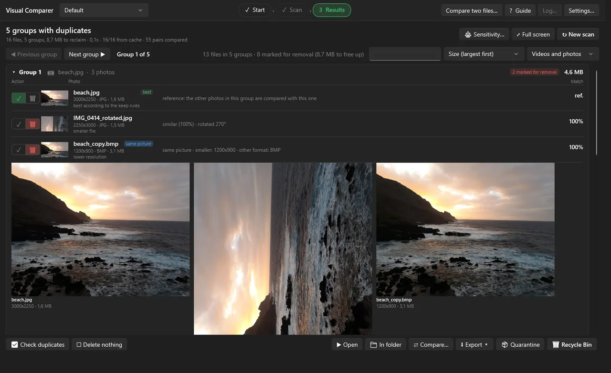
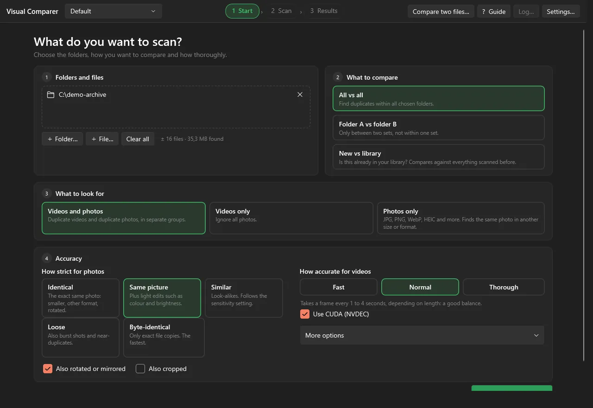
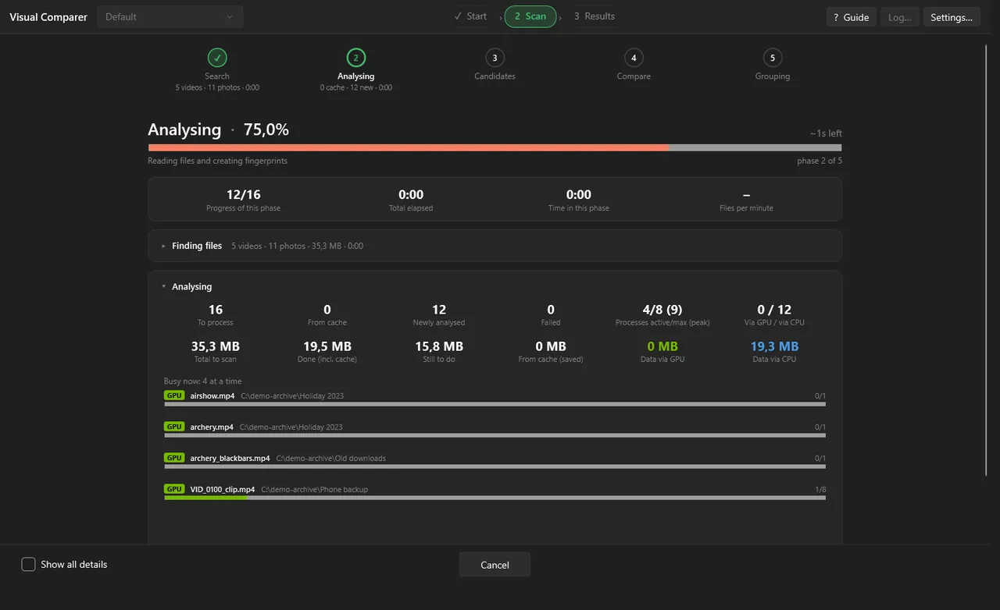
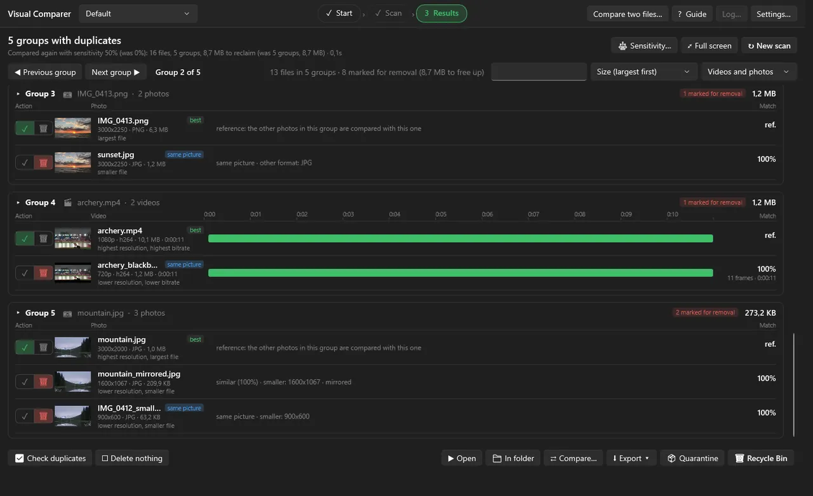
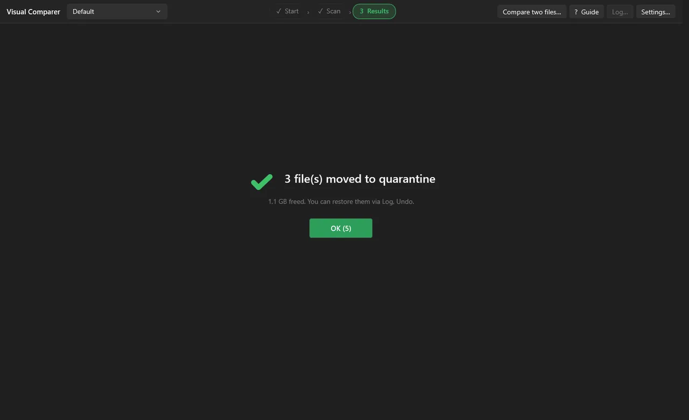
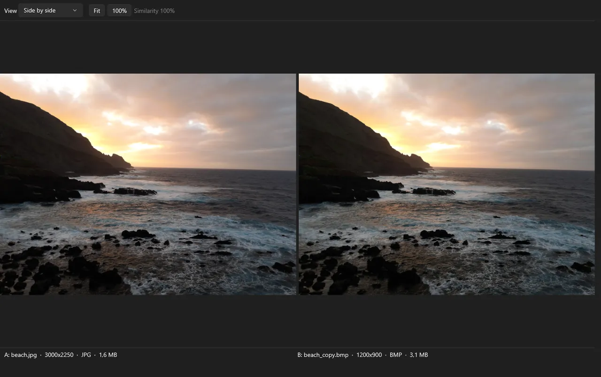
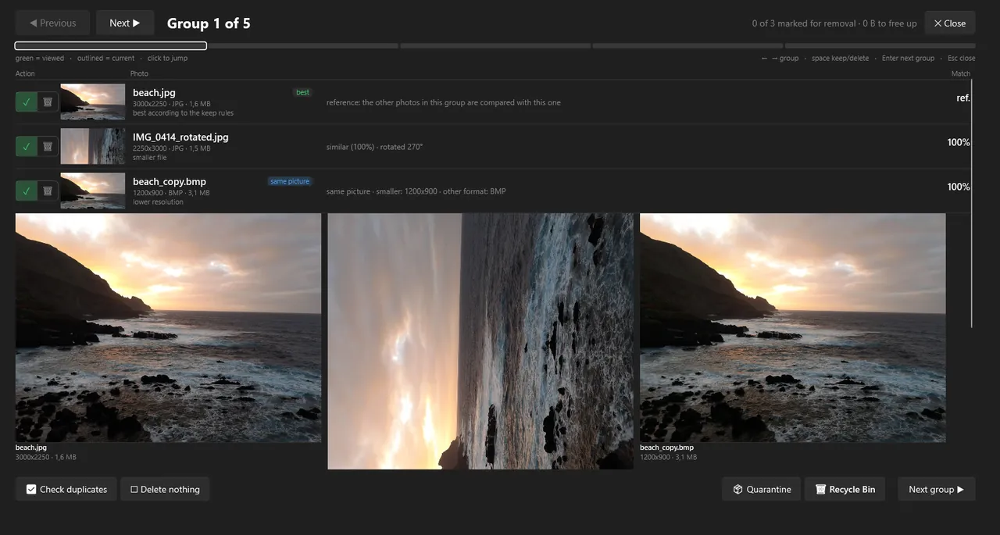

# Visual Comparer for Windows

**Find duplicate photos and videos by what you see, not by their name.**

Visual Comparer finds copies that were resized, re-saved, re-encoded, rotated or cropped, lets you compare them side by side, and cleans up safely.
Free for Windows 10 and 11. Everything runs on your own PC: no account, no telemetry, nothing is uploaded.

> 📱 **Looking for Android?** Visual Comparer also exists for phones and tablets: **[VisualComparerMobile](https://github.com/ericbruggema/VisualComparerMobile)**.

  

| | |
|---|---|
| **Latest version** | 1.0.0 (free edition) |
| **Platform** | Windows 10 and 11, 64-bit. No .NET and no administrator rights needed |
| **Download** | [Releases](https://github.com/ericbruggema/VisualComparer/releases/latest): installer (`-Setup.exe`) or portable zip |
| **Free edition limit** | up to **500 videos** and **2,500 photos** per scan |
| **Languages** | English, Dutch, German |
| **License** | Proprietary freeware, see [LICENSE.txt](LICENSE.txt). The source code is not published |

## Download and start

1. Go to the **[latest release](https://github.com/ericbruggema/VisualComparer/releases/latest)** and pick one:
   * **`VisualComparer-<version>-Setup.exe`**: the installer. It installs for your own user account by default (no administrator rights needed), adds a Start menu entry and an uninstaller. You can also choose to install for all users.
   * **`VisualComparer-<version>-portable-win-x64.zip`**: the portable version. Unzip it anywhere (a folder on your disk, a USB stick) and start `VisualComparer.exe`. Nothing is written to the registry.
2. Start the program, read and accept the terms, and read the short guide that follows.
3. Drop a folder on the window and press **Start scan**.

Windows may show a *SmartScreen* warning the first time, because the program is not code-signed yet. Read [Installation](docs/installation.md#windows-warns-about-the-file) for what that means and how to check your download with the SHA-256 sums that come with every release.

## What makes it different

Most duplicate finders compare file names, sizes or checksums, so they only catch exact copies. Visual Comparer looks at the picture itself.

| Situation | Typical finder | Visual Comparer |
|---|:---:|:---:|
| The exact same file, copied twice | ✓ | ✓ (SHA-256 checked) |
| A photo saved smaller, in another format or quality | ✗ | ✓ |
| A video re-encoded with another resolution, bitrate or container | ✗ | ✓ |
| Rotated, mirrored or cropped; added black bars | ✗ | ✓ |
| A clip cut from a longer video, or the same video with another intro | ✗ | ✓ |
| Different speed (24 ↔ 25 fps), a watermark or burned-in subtitles | ✗ | ✓ |
| Photos and videos in one scan, in one result list | often separate tools | ✓ |
| See which part of two videos matches, on a shared timeline | ✗ | ✓ |
| Compare two files yourself: wipe slider, flicker, difference view, PSNR, SSIM, VMAF | ✗ | ✓ |
| Change the sensitivity afterwards without scanning again | ✗ | ✓ (uses the cache) |
| Keep results per library and continue after a restart | ✗ | ✓ |
| Undo a clean-up through a quarantine folder and a log | rarely | ✓ |

### Highlights

* **One tool for photos and videos**: one scan, one result list, separate groups.
* **It shows its reasoning**: every group shows how strong the match is and which part matches. You are not asked to trust a bare list of files.
* **Safe by design**: Recycle Bin or quarantine, an undo log, protected folders, a check just before deleting, and a whole group is never removed at once.
* **Fast on big archives**: an index picks candidate pairs, so it does not compare every file with every other, and a cache makes repeat scans almost instant. Archives of two million photos have been tested.
* **Private and portable**: all data stays in a folder next to the program (or in your user profile when the program folder is read-only).
* **Honest about limits**: the weak spots are listed in the [FAQ](docs/faq.md#what-does-it-not-do-well), so you know what to expect before you start.

## How it works in four steps

| 1. Pick folders | 2. Scan |
|:---:|:---:|
|  |  |
| Choose what to compare (everything against everything, folder A against folder B, or new files against your library), what to look for (photos, videos or both) and how strict to be. | Every photo and video is analysed once and fingerprinted. You see each phase live, can cancel at any time, and what was analysed is kept in the cache. |

| 3. Read the results | 4. Clean up safely |
|:---:|:---:|
|  |  |
| Every group is one picture or video in several versions. The best one (by your rules) is kept; each copy says why it matched. For videos a bar on a shared timeline shows which part matches. | Move the ticked files to quarantine or the Recycle Bin. A log lets you undo. Protected folders are never touched. |

Read the full walk-through in **[Getting started](docs/getting-started.md)**.

### Compare two files yourself

Put two files side by side with linked zoom and pan, drag a wipe slider across them, flicker between them, or show the difference as a heat map. For videos you also get synchronised playback, frame stepping and PSNR, SSIM and VMAF scores.

### Review a big archive group by group

The full-screen review walks through the groups one by one with the keyboard: arrow keys to move, space to keep or remove, Enter for the next group.

## Documentation

| Guide | What is in it |
|---|---|
| [Getting started](docs/getting-started.md) | The four steps, with every choice explained |
| [Installation](docs/installation.md) | Installer or portable, where your data lives, Windows warnings, checking your download, updating, removing |
| [How matching works](docs/how-it-works.md) | Fingerprints, the index, what is found and what is not |
| [Photos](docs/photos.md) | The five strictness levels, rotated/mirrored/cropped copies, supported formats |
| [Videos](docs/videos.md) | The three accuracy profiles, clips, speed changes, CUDA |
| [Results and clean-up](docs/results-and-cleanup.md) | Reading groups, the comparer, keep rules, quarantine, undo, export, shortcuts |
| [Libraries and settings](docs/settings.md) | Libraries, scan modes, filters, every setting |
| [Performance](docs/performance.md) | Where the time goes, speed of photos and videos, memory, tips |
| [FAQ and troubleshooting](docs/faq.md) | Short answers to the questions people ask most |
| How-to guides | [Duplicate photos](docs/guides/find-duplicate-photos.md) · [Duplicate videos](docs/guides/find-duplicate-videos.md) · [Resized, rotated or cropped photos](docs/guides/find-resized-rotated-cropped-photos.md) · [Clean up backups](docs/guides/clean-up-backups.md) |

## Supported formats

* **Photos**: `.jpg` `.jpeg` `.jfif` `.png` `.webp` `.bmp` `.tif` `.tiff` `.gif` `.heic` `.heif` `.avif`. Common formats are read with the built-in Windows image reader (fast); everything else, and anything Windows cannot read, falls back to the bundled ffmpeg. HEIC, HEIF and AVIF work when Windows or ffmpeg can decode them. RAW camera files (CR2, NEF, ARW and similar) are not supported.
* **Videos**: `.mp4` `.mkv` `.avi` `.mov` `.wmv` `.flv` `.webm` `.m4v` `.mpg` `.mpeg` `.ts` `.m2ts` `.mts` `.3gp` `.ogv` `.vob` `.divx`. Codecs include H.264, H.265/HEVC, VP9, AV1 and MPEG-2, as far as the bundled ffmpeg supports them. Damaged files are listed separately.

You can change the list of extensions per scan in Settings, and exclude folders or patterns.

## Specifications

| | |
|---|---|
| Photo matching | Five strictness levels from byte-identical to loosely alike, plus optional rotated/mirrored and cropped matching |
| Video matching | Re-encodes, resolution, bitrate, container, crop, black bars, rotation, mirroring, clips, time shift, speed changes, watermarks and subtitles. Three profiles: Fast, Normal and Thorough |
| Scan modes | Everything against everything, folder A against folder B, or new files against a library |
| Scale | Tens of thousands of files are routine; two million photos have been compared in a few minutes (after the first analysis). Candidate pairs come from an index and fingerprints are cached in a local database |
| Speed-up | Optional NVIDIA CUDA decoding and an optional GPU alignment mode (DirectX 12, so other video cards work too) |
| Libraries | Keep several folder sets (for example "Holiday 2024", "Downloads"). Results are saved per library and restored after a restart |
| Privacy | Local only. No account, no telemetry, the program does not contact any server |

## Free edition

This release is the **free edition**: a scan processes up to **500 videos** and **2,500 photos** (the first files in the order of your folders; photos and videos have their own limit). Everything else works without restrictions. If a scan is cut short, the program tells you how many files were skipped, and you can scan the remaining folders in another run. Later versions may be offered in other editions; the terms are published with each release.

## Safety and disclaimer

Visual Comparer helps you find files that look alike. It can make mistakes: files may be grouped that are not the same, and copies may be missed. **You decide what is removed, and you are responsible for it.** Look at a group before you delete, use quarantine first, and keep a backup of everything you cannot afford to lose. See [LICENSE.txt](LICENSE.txt) for the full terms; the same terms are shown in the program on first start.

## Support and feedback

* **Bugs and questions**: open an [issue](https://github.com/ericbruggema/VisualComparer/issues). Please say which version you use, what you did and what you expected. A `crash.log` (found next to the program or in the data folder) helps a lot. Do not attach photos or videos you want to keep private.
* There is no guaranteed support or response time.
* **Source code**: the source is closed. This repository only contains documentation, release downloads and an issue tracker.

## Third-party components

Visual Comparer uses FFmpeg (GPL v3, bundled unmodified and started as a separate program), SQLite, ComputeSharp and .NET. See [THIRD-PARTY-NOTICES.md](THIRD-PARTY-NOTICES.md) for licences and where to get the FFmpeg source code.

## Related

* 📱 **[VisualComparerMobile](https://github.com/ericbruggema/VisualComparerMobile)**: the Android version, with the same idea and its own documentation.

© 2026 Eric Bruggema. All rights reserved.
