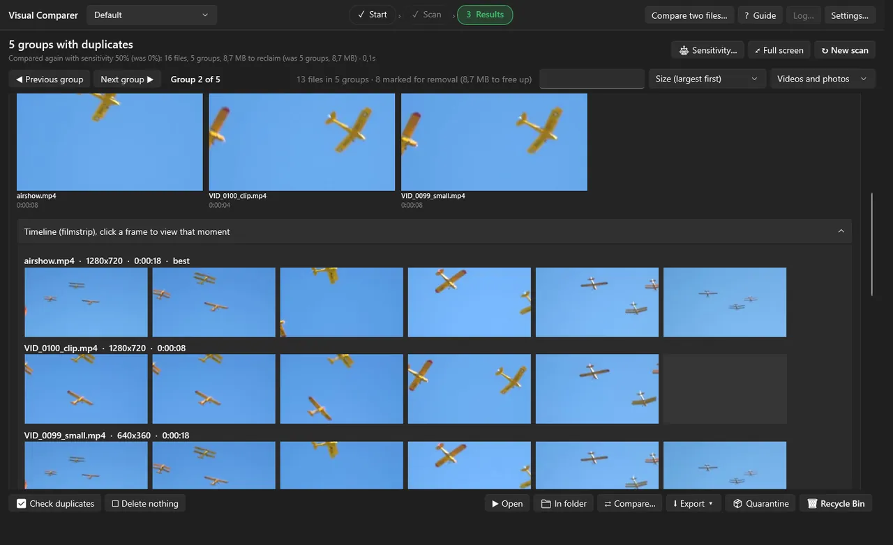

# Videos

[← Back to the overview](../README.md)

How Visual Comparer treats videos: the accuracy profiles, what is found, the timeline bars and how to speed things up.

## Accuracy profiles

On the start screen (card 4, *How accurate for videos*) you pick how closely each video is sampled.

| Profile | How often a picture is taken | Use it for |
|---|---|---|
| **Fast** | about every 4 seconds | A first rough check of a big library. Can miss speed changes and very short clips. |
| **Normal** *(default)* | every 1 to 4 seconds, depending on the length of the video | Daily use; a good balance. |
| **Thorough** | every 0.5 to 2 seconds | Short clips and speed differences. The slowest. |

A higher **sensitivity** (under *More options*) gives looser matches and more false ones; a lower sensitivity is stricter. You can change the sensitivity after the scan without reading your folders again.

## What is found

* Re-encodes, another resolution, bitrate or container (for example MKV instead of MP4).
* Black bars, crops, 90°/180°/270° rotation and mirroring.
* **A clip taken from a longer video**, or a video with another intro. The clip shows up in the group of the longer video, with a shorter bar, so you can see it is only part of it.
* Another **speed**, such as 24 versus 25 frames per second (Normal or Thorough).
* A **watermark** or burned-in **subtitles**.

Only the **picture** is compared, **not the sound**.

## The timeline bar

For each video in a group, a bar on a **shared timeline** shows which part matches the best version (the reference): a full bar for a full copy, a short bar for a clip. To the right you see the percentage and how many frames and seconds match, for example *40 frames · 0:00:40*.

* **Click or drag on a bar** and every copy of the group jumps to the same scene.
* Open the **film strip** (*Timeline*) to see frames of every copy next to each other.
* The label **identical** means the files are byte for byte the same (verified in the background with SHA-256); **same picture** means a different file with a 100% identical picture.

## Compare two videos yourself

Press **Compare…** for the video comparer:

* Views: **side by side**, **wipe slider**, **A/B flicker**, **difference heat map**, only A, only B.
* Synchronised playback that honours the offset and speed that were found, **frame stepping**, linked zoom and pan, a manual time offset, *next difference*, and a snapshot as PNG.
* **PSNR, SSIM and VMAF** over a fragment you choose. Black bars are cropped away automatically and B can be rotated or mirrored, so copies with a different framing are compared fairly.

Keyboard shortcuts in the comparer: `Space` play/pause · `←` / `→` one frame (`Shift` one second, `Ctrl` ten seconds) · `Home` to the start · `1`–`6` choose the view · mouse wheel zooms · drag to pan.

## Speed

* **NVIDIA CUDA (NVDEC)**: video decoding and shrinking on the graphics card, automatically from 720p upwards, with a fallback to the processor. Leave *Use CUDA* on if you have an NVIDIA card.
* **GPU alignment** *(optional, Settings → Compare, off by default)*: aligns the video pairs on the graphics card (DirectX 12, so other brands work too) with exactly the same result as on the processor. Useful for libraries with many long videos.
* **Compare resolution** (Settings → Compare): the number of points per video that are compared. *Automatic* adapts to the memory and processor of your PC; a calculator shows the expected memory and time.
* Network drives are slower than local drives. A quick estimate on the start screen shows how many files and how much data you are about to scan.

## Supported formats and codecs

`.mp4` `.mkv` `.avi` `.mov` `.wmv` `.flv` `.webm` `.m4v` `.mpg` `.mpeg` `.ts` `.m2ts` `.mts` `.3gp` `.ogv` `.vob` `.divx`

Codecs include H.264, H.265/HEVC, VP9, AV1 and MPEG-2, as far as the bundled ffmpeg supports them. Damaged files that cannot be read are listed separately (**⚠ Broken videos**), with checkboxes to quarantine or delete them. You can change the list of extensions in *Settings → Scan*.

## Good to know

* The free edition handles up to **500 videos** per scan.
* The first scan of a big library takes a while; later scans only analyse new or changed files.
* The program waits up to 60 seconds for the properties of one video (a slow network drive or a damaged file) and then gives up on that file, so one bad file never blocks a scan.
* Always look at a group before you delete. A match percentage is an indication.
